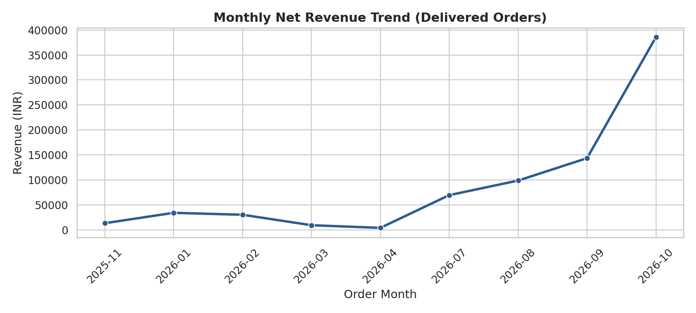
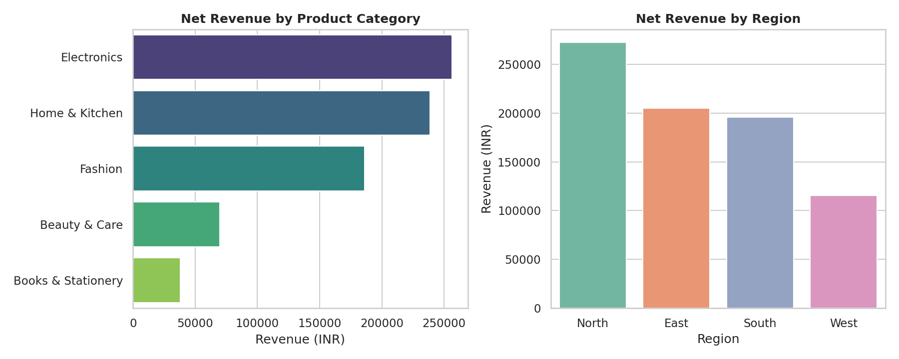
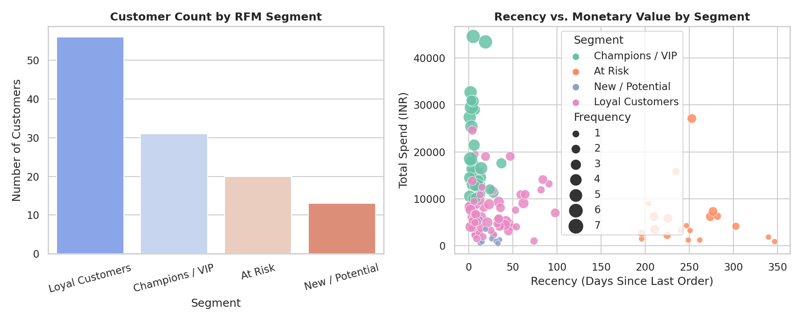
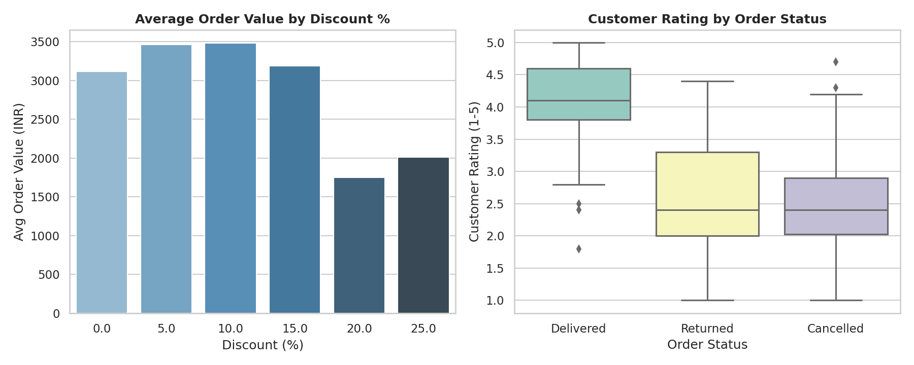

# E-Commerce Customer Segmentation & Sales Performance Analysis

A beginner-friendly data analysis project for **B.Tech 1st Year – Data Analyst** learners.
It analyzes e-commerce sales drivers and segments customers using **RFM (Recency, Frequency, Monetary)** analysis with Python, pandas, matplotlib, and seaborn.

> The dataset is **synthetic** (computer-generated). It contains no real customer or transaction data.

## Business problem
An online retail store wants to understand which product categories and regions drive revenue, evaluate discount effectiveness, and segment customers so marketing teams can retain high-value buyers and re-engage at-risk customers.

## Questions answered
1. What is the overall sales performance (net revenue, average order value, return/cancellation rate, and monthly trend)?
2. Which product categories and regions generate the highest revenue?
3. How do customers segment using RFM (Recency, Frequency, Monetary) scores?
4. How do discounts affect order value, and how do ratings differ across delivered vs. returned/cancelled orders?

## Dataset
`data/raw/ecommerce_sales_data.csv` – 371 rows, 15 columns (`Order_ID`, `Order_Date`, `Customer_ID`, `Age`, `Gender`, `Region`, `Category`, `Product_Name`, `Quantity`, `Unit_Price`, `Discount_Pct`, `Total_Sales`, `Payment_Method`, `Order_Status`, `Customer_Rating`).
The raw file intentionally contains missing values, duplicate rows, inconsistent text casing/whitespace, and impossible outlier values to practice end-to-end data cleaning.

## Project structure
```
ABES_DA_Ecommerce_Customer_Segmentation_Project/
├── data/
│   ├── raw/ecommerce_sales_data.csv
│   └── processed/ecommerce_sales_clean.csv
├── notebooks/ecommerce_customer_segmentation_analysis.ipynb
├── images/ (charts saved by the notebook)
├── scripts/generate_data.py (creates the synthetic dataset)
├── requirements.txt
├── .gitignore
└── README.md
```

## How to run
```bash
git clone https://github.com/panditaadityashukla123-boop/ecommerce-customer-segmentation.git
cd ecommerce-customer-segmentation
pip install -r requirements.txt
jupyter notebook notebooks/ecommerce_customer_segmentation_analysis.ipynb
```

## Steps followed
1. Load and inspect raw transaction data
2. Clean data (remove 6 duplicate rows, standardize `Region` & `Category` text, fix impossible `Age`/`Quantity`/`Discount_Pct` outliers, impute missing values, and recalculate `Total_Sales`)
3. Engineer features (`Order_Month` and customer-level `Recency`, `Frequency`, `Monetary`, and `Segment`)
4. Exploratory data analysis with 4 visual charts
5. Business insights and retention recommendations

## Key findings (from this dataset)
- **Net Delivered Revenue:** ₹788,884.35 across 249 delivered orders (out of 365 unique orders), with an Average Order Value (AOV) of ₹3,168.21 and a 31.8% return/cancellation rate.
- **Top Revenue Drivers:** **Electronics** leads all categories (₹256,243.95), and the **North** region generates the highest regional sales (₹272,420.40).
- **Customer Segments (RFM):** Customers naturally separate into **Champions / VIP**, **Loyal Customers**, **New / Potential** buyers, and **At Risk** customers (inactive for 150+ days).
- **Ratings & Fulfillment:** Delivered orders average 4.15/5 in customer ratings, whereas returned/cancelled orders drop to 2.56/5, highlighting fulfillment quality as a key retention lever.

## Charts





## Tools
Python 3 · pandas · NumPy · matplotlib · seaborn · Jupyter Notebook · Git and GitHub

## Author
Aaditya Shukla – B.Tech 1st Year (CSE - AIML), ABES Engineering College
