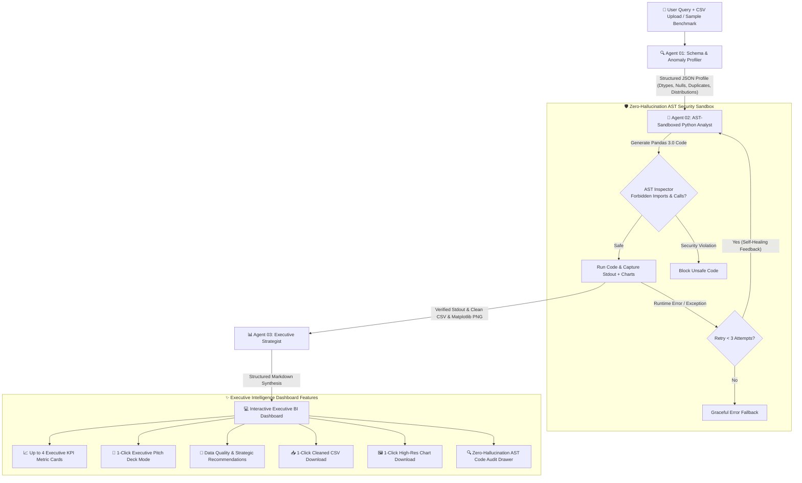

# 🚀 AgentOps BI Studio: Autonomous Multi-Agent CSV Analyst & Executive Intelligence Platform

[](https://www.python.org/)
[](https://langchain-ai.github.io/langgraph/)
[](https://groq.com/)
[](https://flask.palletsprojects.com/)
[-brightgreen.svg)](test/test_agent_pipeline.py)
[](https://www.w3.org/WAI/WCAG21/quickref/)
[](api/security.py)

> **Hackathon Track:** Generative AI / Agentic AI & Automated Business Intelligence  
> **Core Innovation:** A deterministic, zero-hallucination, self-healing 3-agent pipeline orchestrated with LangGraph that cleans messy operational CSVs, verifies execution in an AST sandbox, and builds interactive executive dashboards in seconds.

---

## 📌 Problem Statement

In real-world business operations, domain experts and executives make critical decisions based on messy tabular data. However:
- **70%+ of Analyst Time Wasted:** Teams waste hours writing repetitive data cleaning scripts, fixing null values, deduplicating records, and resolving subtle Pandas 3.0 Copy-on-Write warnings.
- **LLM Hallucinations in Financial/Business Data:** Plain LLMs (like standard ChatGPT) frequently invent plausible-sounding numbers, miscalculate sums, or hallucinate metrics when answering questions over tabular data.
- **Code Execution Vulnerabilities:** Blindly running LLM-generated code (`eval()` / `exec()`) introduces catastrophic Remote Code Execution (RCE) and container breakout risks.

---

## 💡 Solution: Self-Healing 3-Agent LangGraph Architecture

AgentOps BI Studio solves this through **tri-agent orchestration**, where analytical reasoning, verifiable code execution, and executive reporting are decoupled into specialized agents connected by a self-healing retry loop.



---

## 🤖 The 3 Autonomous Agents Explained

| # | Agent Name | Core Responsibility | Verification & Guarantee |
|---|---|---|---|
| **01** | **Schema & Quality Profiler** | Ingests raw tabular data, computes row/column dimensions, detects duplicate rows, missing value percentages, and infers semantic types. | Pure deterministic Pandas extraction — no LLM tokens wasted on raw parsing. |
| **02** | **AST-Sandboxed Pandas Analyst** | Generates tailored data cleaning and aggregation code, normalizes casing (`.str.strip().str.title()`), saves cleaned output, and plots statistical charts. | Static AST tree validation blocks `os`, `sys`, `subprocess`, `socket`, `eval`, `open`. Automatically retries with traceback feedback up to 3 times if bugs occur. |
| **03** | **Executive Strategist** | Reads *only* the verified stdout numbers and schema metadata to produce an executive briefing with formatted Markdown tables, KPI callouts, and strategic action items. | Zero hallucination guarantee: Strategist is strictly forbidden from computing math; it synthesizes verified facts. |

---

## 🛡️ Enterprise Security & Hardening

1. **Abstract Syntax Tree (AST) Inspection:** Evaluates the Python AST before `exec()`. Any attempt to import unauthorized libraries or call dangerous functions throws an immediate `SecurityError`.
2. **Formula Injection Neutralization:** All CSV exports are sanitized against spreadsheet command injection (`=`, `+`, `-`, `@`, `\t`, `\r`).
3. **Sliding-Window Rate Limiting:** Enforces an in-memory per-IP sliding window (30 requests / 60 seconds) to prevent DoS attacks.
4. **OWASP Security Headers:** Every HTTP response includes `Content-Security-Policy` (CSP), `Strict-Transport-Security` (HSTS), `X-Content-Type-Options: nosniff`, `X-Frame-Options: DENY`, and `Referrer-Policy`.
5. **CSV Byte Validation:** Inspects file bytes before parsing to reject binary payloads, executable masquerading, and oversized files (>5 MB).

---

## ♿ Accessibility & UI/UX Design (WCAG 2.1 AA)

- **Semantic HTML5 Landmarks:** Built with `<header>`, `<main>`, `<section>`, and `<nav>` landmarks.
- **Skip Navigation:** Keyboard users can press `Tab` on load to skip directly to `#main-content`.
- **Keyboard & Screen Reader Ready:** Explicit `<label for>` bindings, high-contrast focus rings, and `aria-live="polite"` feedback during agent orchestration.
- **Executive Export Suite:** One-click Cleaned CSV export, PNG chart download, Markdown report copy, `.md` file download, and Print-to-PDF formatting.

---

## 📁 Repository Structure

```
├── api/
│   ├── index.py              # Flask serverless application & request routing
│   ├── security.py           # OWASP headers, rate limiter, CSV sanitization & validator
│   ├── renderer.py           # Markdown-to-HTML parser & verified KPI extractor
│   ├── views.py              # High-fidelity dashboard view templates
│   └── __init__.py
├── multi_agent/
│   └── universal_analyst_agent.py  # LangGraph 3-agent orchestration & AST sandbox
├── data/
│   └── raw/
│       ├── ecommerce_sales_data.csv       # E-Commerce RFM Benchmark (371 rows)
│       ├── edtech_student_enrollments.csv # EdTech Analytics Benchmark (184 rows)
│       └── food_delivery_operations.csv   # Food Delivery Benchmark (250 rows)
├── test/
│   └── test_agent_pipeline.py  # 12 automated unit, security & integration tests
├── .github/workflows/
│   └── ci.yml                # Automated GitHub Actions CI pipeline
├── app.py                    # Root local development entry point
├── requirements.txt          # Python dependencies
├── vercel.json               # Vercel serverless deployment configuration
└── README.md
```

---

## ⚡ Quick Start Guide

### 1. Prerequisites
- Python 3.10+ (Python 3.12 recommended)
- A free **Groq API Key** ([Get one here](https://console.groq.com/keys))

### 2. Installation
```bash
git clone https://github.com/aaditya-cse/Ecommerce-_Segementation_and_Sales_Performance_Project.git
cd Ecommerce-_Segementation_and_Sales_Performance_Project

# Create and activate virtual environment
python -m venv .venv
# On Windows:
.venv\Scripts\activate
# On macOS/Linux:
source .venv/bin/activate

# Install dependencies
pip install -r requirements.txt
```

### 3. Configure Environment
Create a `.env` file in the root directory (or use `.env.example`):
```bash
cp .env.example .env
```
Edit `.env` and paste your Groq API key:
```env
GROQ_API_KEY=gsk_your_groq_api_key_here
PORT=5000
```

### 4. Run the Local Web App
```bash
python app.py
```
Open **`http://127.0.0.1:5000`** in your browser.

### 5. Run the Automated Test Suite
```bash
pytest -v
```
All 12 automated tests will execute and pass:
```text
test/test_agent_pipeline.py::test_schema_profiler_detects_duplicates_and_nulls PASSED
test/test_agent_pipeline.py::test_ast_security_blocks_dangerous_code PASSED
test/test_agent_pipeline.py::test_ast_security_allows_safe_pandas_code PASSED
test/test_agent_pipeline.py::test_clean_llm_text_strips_think_tags PASSED
test/test_agent_pipeline.py::test_langgraph_compiles_cleanly PASSED
test/test_agent_pipeline.py::test_flask_home_page_accessibility_and_headers PASSED
test/test_agent_pipeline.py::test_security_headers_csp_and_hsts PASSED
test/test_agent_pipeline.py::test_csv_formula_injection_sanitization PASSED
test/test_agent_pipeline.py::test_csv_bytes_validation_rejects_binary_and_empty PASSED
test/test_agent_pipeline.py::test_rate_limiter_enforces_threshold PASSED
test/test_agent_pipeline.py::test_post_rejects_invalid_sample_path_traversal PASSED
test/test_agent_pipeline.py::test_kpi_extractor_and_markdown_table_renderer PASSED

============================= 12 passed in 8.49s =============================
```

---

## 🎯 3-Minute Hackathon Pitch Walkthrough

When presenting to judges:

1. **The Hook (30 sec):**  
   *"Judges, businesses run on tabular CSV data, but LLMs cannot be trusted to do math, and running generated code is an enterprise security hazard. We built **AgentOps BI Studio**—an autonomous multi-agent system powered by LangGraph that solves this with a self-healing AST sandbox."*

2. **The Live Demo (90 sec):**  
   - Select the built-in **E-Commerce Sales & RFM Segmentation** dataset.
   - Click one of the quick chips: *"Clean duplicates and missing values, summarize top KPIs, and plot the primary revenue driver."*
   - Hit **Launch Executive Dashboard &rarr;**.
   - Show the dynamic loading pipeline progressing through all 3 agents in real-time.
   - Reveal the generated dashboard:
     - **Executive KPI Cards** extracted directly from verified stdout.
     - **Cleaned Dataset Preview** with live client-side row filtering.
     - **Generated Statistical Visualization** with one-click PNG download.
     - **Cleaned CSV Download** with formula injection safeguards.

3. **The 'Under The Hood' Closer (60 sec):**  
   - Click **Show AST-Verified Code & Trace**: show the judges the actual Python code generated by the agent and verified by the AST analyzer.
   - Mention the **Self-Healing Loop**: *"If this code had raised an IndexError or NaN bug, LangGraph catches the traceback and re-prompts Agent 02 to heal itself autonomously before presenting to the user."*
   - Mention the **12/12 Automated Test Suite** and **WCAG 2.1 AA** accessibility compliance.

---

## 👥 Contributors & Acknowledgements

- **Developed for:** Agentic AI & Generative Business Intelligence Hackathon
- **Frameworks:** LangGraph, LangChain, Groq, Flask, Pandas, Seaborn, Pytest
