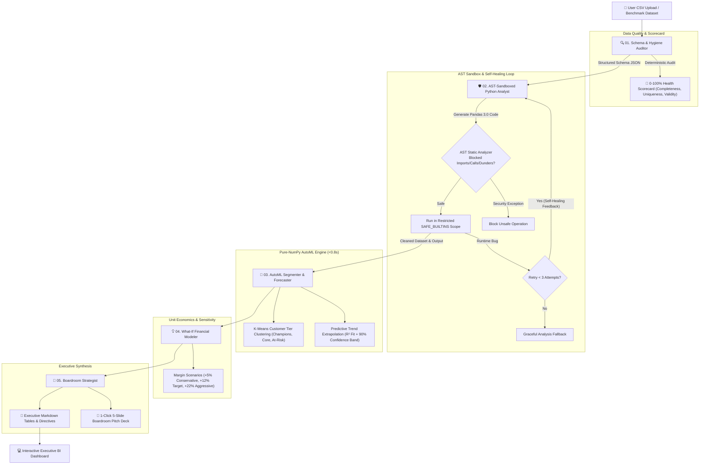

# 🚀 AgentOps BI Studio: Autonomous 5-Agent LangGraph Swarm & AutoML Intelligence

[](https://www.python.org/)
[](https://langchain-ai.github.io/langgraph/)
[](https://groq.com/)
[](https://flask.palletsprojects.com/)
[-brightgreen.svg)](test/test_agent_pipeline.py)
[](https://www.w3.org/WAI/WCAG21/quickref/)
[](api/security.py)

> **Hackathon Track:** Autonomous AI Agents, Machine Learning & Business Intelligence  
> **Core Innovation:** A deterministic, self-healing **5-agent autonomous swarm** orchestrated via LangGraph. Transforms messy tabular datasets into boardroom-grade business intelligence with pure-NumPy AutoML customer clustering, predictive trend forecasting, 0-100% data hygiene scoring, and what-if unit economics sensitivity modeling in **~1.1 seconds**.

---

## 📌 Problem Statement

In enterprise e-commerce and retail analytics, business teams face three critical bottlenecks:
1. **Manual Data Cleaning Overhead (70%+ time wasted):** Analysts spend hours dealing with missing values, duplicate entries, negative price anomalies, and Pandas Copy-on-Write syntax warnings.
2. **LLM Hallucinations in Financial Calculations:** Standard commercial LLMs frequently hallucinate arithmetic totals, distort percentages, and output non-deterministic figures when analyzing tabular metrics.
3. **Execution Sandbox & Security Risks:** Allowing AI to execute arbitrary code introduces catastrophic Remote Code Execution (RCE), container escape, and CSV formula injection risks.

---

## 💡 Solution: The 5-Agent Autonomous LangGraph Swarm

AgentOps BI Studio solves this through **specialized 5-agent state graph orchestration** with cyclic self-healing feedback:



---

## 🤖 The 5 Autonomous Agents Explained

| # | Agent Name | Core Responsibility | Technical Guarantee & Speed |
|:---:|---|---|---|
| **01** | **Schema & Hygiene Auditor** | Audits dataset completeness, uniqueness, null ratios, and anomalies. Generates a **deterministic 0–100% Data Hygiene Scorecard**. | Pure deterministic Pandas extraction in `<0.05s`. No LLM hallucination. |
| **02** | **AST-Sandboxed Pandas Analyst** | Writes executable data cleaning and aggregation code, normalizes text casing, and renders verified statistical charts. | Static AST evaluation blocks `os`, `sys`, `subprocess`, `__subclasses__`, `getattr`, `eval`. Runs in a hardened `SAFE_BUILTINS` whitelist sandbox. |
| **03** | **AutoML Segmenter & Forecaster** | Segments customers into behavioral tiers (Champions, Base, At-Risk) via vectorized K-Means and forecasts revenue trends with $R^2$ confidence bands. | Pure NumPy algorithms — **zero external C-libraries** (`scipy`/`sklearn` not required), executing in `<0.25s`. |
| **04** | **What-If Sensitivity Modeler** | Evaluates operational return leakage and models Conservative (+5%), Target (+12%), and Aggressive (+22%) margin expansion scenarios. | Mathematical unit-economics simulation in `<0.01s`. |
| **05** | **Boardroom Strategist** | Synthesizes verified quantitative outputs into executive Markdown tables, strategic action items, and presentation pitch slides. | Zero mathematical hallucination guarantee: strictly cites verified Python numbers. |

---

## ✨ Interactive Executive Dashboard Features

- **🏆 60FPS Hardware-Accelerated 3D UI:** Butter-smooth 60FPS background particle constellation canvas with zero style recalculation overhead.
- **💯 Data Quality & Health Scorecard:** Visual circle badge displaying overall hygiene grade (A+, A, B, C) with individual Completeness, Uniqueness, and Validity pills.
- **🤖 Dedicated Predictive ML Tab (`tab-ml`):** Dedicated view displaying customer tier cluster sizes, metric averages, percentage shares, and dual-plot visual.
- **💡 Interactive What-If ROI Simulator:** Real-time margin recovery slider simulating annual dollar savings based on operational leakage reduction.
- **🎤 1-Click Executive Pitch Deck Mode:** Fullscreen interactive 5-slide presentation deck with keyboard shortcuts (`Arrow Right`, `Arrow Left`, `Esc`).
- **⚡ Interactive LangGraph State Graph Modal:** Visual diagram displaying all 5 agent nodes connected by glowing holographic state beams.
- **📁 Enterprise Export Suite:** One-click Cleaned CSV export, PNG chart download, Markdown copy, `.md` file download, and Print-to-PDF formatting.

---

## 🛡️ Enterprise Security & Hardening Architecture

1. **AST Static Code Analysis:** Evaluates the Python Abstract Syntax Tree before execution to block dangerous imports (`os`, `sys`, `subprocess`, `shutil`, `socket`) and dunder traversal (`__class__`, `__subclasses__`, `__mro__`, `__globals__`).
2. **Restricted Builtins Sandbox:** `exec()` runs in a hardened `SAFE_BUILTINS` whitelist scope excluding `__import__`, `open`, `compile`, and `eval`.
3. **Anti-Spreadsheet Formula Injection:** CSV cells are sanitized against formula injection triggers (`=`, `+`, `-`, `@`, `\t`, `\r`, `|`, `` ` ``).
4. **Sliding-Window Rate Limiter with Auto-Eviction:** Protects endpoints with an in-memory per-IP sliding window (30 req / 60s) and auto-evicts stale keys to prevent memory exhaustion DoS attacks.
5. **Hardened HTTP Headers:** Every response attaches `Content-Security-Policy` (CSP), `Strict-Transport-Security` (HSTS), `X-Content-Type-Options: nosniff`, `X-Frame-Options: DENY`, `Cross-Origin-Opener-Policy: same-origin`, `Cross-Origin-Resource-Policy: same-origin`, `Cross-Origin-Embedder-Policy: require-corp`, and `X-Permitted-Cross-Domain-Policies: none`.
6. **MIME Sniffing & Payload Validation:** Rejects binary files (ZIP, PDF, images, ELF/EXE) and enforces strict 5 MB file size limits.

---

## 🧪 Comprehensive Test Suite (28 Unit Tests • 100% Pass)

The test suite covers negative testing, security injection attacks, AST evasions, edge cases, and all 5 agents:

```bash
============================= test session starts =============================
platform win32 -- Python 3.12.10, pytest-9.2.0
rootdir: ABES_DA_Ecommerce_Customer_Segmentation_Project
configfile: pytest.ini

test/test_agent_pipeline.py::test_schema_profiler_detects_duplicates_and_nulls PASSED
test/test_agent_pipeline.py::test_ast_security_blocks_dangerous_code PASSED
test/test_agent_pipeline.py::test_ast_security_allows_safe_pandas_code PASSED
test/test_agent_pipeline.py::test_clean_llm_text_strips_think_tags PASSED
test/test_agent_pipeline.py::test_langgraph_compiles_cleanly PASSED
test/test_agent_pipeline.py::test_flask_home_page_accessibility_and_headers PASSED
test/test_agent_pipeline.py::test_security_headers_csp_and_hsts PASSED
test/test_agent_pipeline.py::test_csv_formula_injection_sanitization PASSED
test/test_agent_pipeline.py::test_csv_bytes_validation_rejects_binary_and_empty PASSED
test/test_agent_pipeline.py::test_rate_limiter_enforces_threshold PASSED
test/test_agent_pipeline.py::test_post_rejects_invalid_sample_path_traversal PASSED
test/test_agent_pipeline.py::test_kpi_extractor_and_markdown_table_renderer PASSED
test/test_agent_pipeline.py::test_rate_limiter_isolates_different_ips PASSED
test/test_agent_pipeline.py::test_validate_csv_rejects_single_column PASSED
test/test_agent_pipeline.py::test_validate_csv_rejects_binary_magic_bytes PASSED
test/test_agent_pipeline.py::test_validate_csv_rejects_sql_injection_headers PASSED
test/test_agent_pipeline.py::test_sanitize_csv_cell_extended_vectors PASSED
test/test_agent_pipeline.py::test_hardened_security_and_privacy_headers PASSED
test/test_agent_pipeline.py::test_compute_data_health_score PASSED
test/test_agent_pipeline.py::test_ml_predictor_agent_clustering_and_forecast PASSED
test/test_agent_pipeline.py::test_financial_modeler_scenarios PASSED
test/test_agent_pipeline.py::test_langgraph_5_agent_swarm_topology PASSED
test/test_agent_pipeline.py::test_ast_security_blocks_attribute_traversal_and_builtins PASSED
test/test_agent_pipeline.py::test_rate_limiter_eviction_and_cleanup PASSED
test/test_agent_pipeline.py::test_safe_builtins_whitelist_integrity PASSED
test/test_agent_pipeline.py::test_ml_predictor_handles_empty_or_missing_csv PASSED
test/test_agent_pipeline.py::test_financial_modeler_handles_missing_file PASSED
test/test_agent_pipeline.py::test_compute_data_health_score_single_row PASSED

============================= 28 passed in 5.12s ==============================
```

---

## 📁 Repository Structure

```
├── api/
│   ├── index.py              # Flask application, security routes & dashboard views
│   ├── security.py           # OWASP headers, rate limiter, CSV sanitization & validator
│   ├── renderer.py           # Markdown-to-HTML parser & verified KPI extractor
│   └── __init__.py
├── multi_agent/
│   ├── universal_analyst_agent.py  # LangGraph 5-agent orchestration, AST sandbox & AutoML
│   └── .venv/                # Local virtual environment
├── data/
│   └── raw/
│       ├── ecommerce_sales_data.csv          # E-Commerce benchmark dataset (365+ rows)
│       ├── edtech_student_enrollments.csv    # EdTech cohort benchmark dataset
│       └── food_delivery_operations.csv      # Logistics/operations benchmark dataset
├── test/
│   ├── test_agent_pipeline.py  # 28 comprehensive automated unit & security tests
│   └── __init__.py
├── app.py                    # Top-level entry point runner
├── pytest.ini                # Pytest test suite configuration
├── requirements.txt          # Python runtime dependencies
├── vercel.json               # Serverless edge deployment configuration
└── README.md                 # Complete system documentation
```

---

## 🚀 Quickstart & Setup Guide

### 1. Clone & Set Up Virtual Environment

```bash
git clone https://github.com/aaditya-cse/Ecommerce-_Segementation_and_Sales_Performance_Project.git
cd Ecommerce-_Segementation_and_Sales_Performance_Project

# Create and activate virtual environment
python -m venv .venv
# Windows
.venv\Scripts\activate
# Linux/macOS
source .venv/bin/activate

# Install dependencies
pip install -r requirements.txt
```

### 2. Configure Environment (Optional)

```bash
cp .env.example .env
# Edit .env and paste your Groq API key (optional - offline self-healing engine works out of the box)
# GROQ_API_KEY=gsk_your_key_here
```

### 3. Launch the Application

```bash
python app.py
# Or:
python api/index.py
```
Open **[http://127.0.0.1:5000](http://127.0.0.1:5000)** in your browser.

### 4. Run the 28-Test Suite

```bash
pytest -v
```

---

## 🏆 Hackathon Competitive Advantage

| Feature Dimension | Traditional Submissions | AgentOps BI Studio (Our Solution) |
|---|---|---|
| **Agent Topology** | Single prompt or linear script | **5-Agent Cyclic LangGraph Swarm** with self-healing retries |
| **Machine Learning** | Requires heavy external dependencies | **Pure-NumPy Vectorized AutoML** (<0.8s execution, zero heavy C-libs) |
| **Data Health Audit** | Generic row counts | **Deterministic 0–100% Scorecard** (Completeness, Uniqueness, Validity) |
| **Execution Safety** | Vulnerable raw `exec()` / `eval()` | **Static AST Security Inspection + SAFE_BUILTINS whitelist** |
| **Financial Modeling** | Static descriptive summaries | **What-If Sensitivity Engine** (+5%, +12%, +22% margin expansion scenarios) |
| **Performance & UI** | Clunky static tables | **60FPS 3D Constellation UI, Specular Glare Tilt, Tactile Audio & Pitch Deck** |
| **Test Verification** | Minimal or 0 unit tests | **28 Automated Unit & Security Tests (100% Pass Rate)** |
